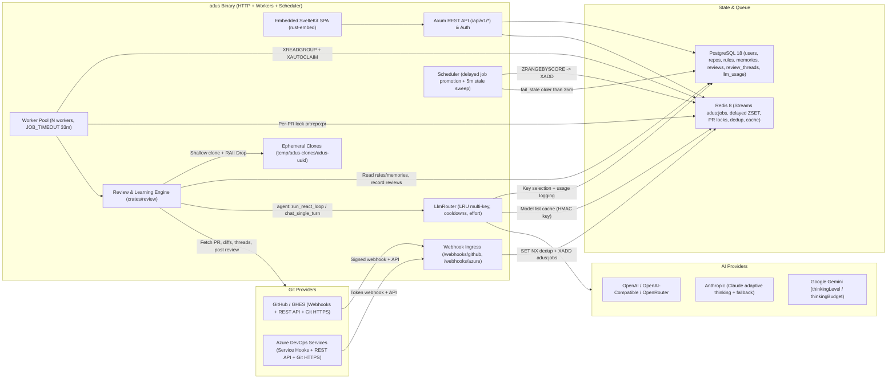
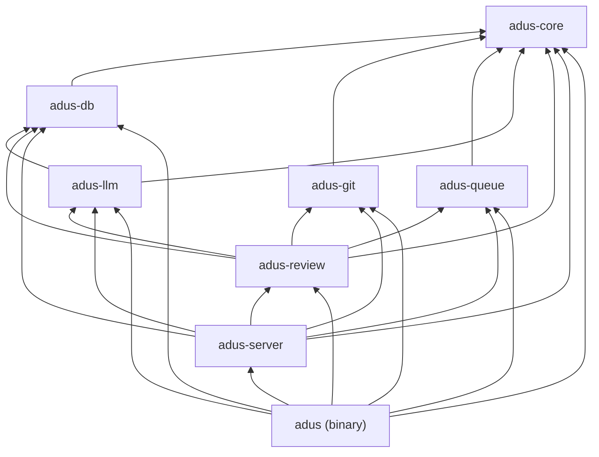
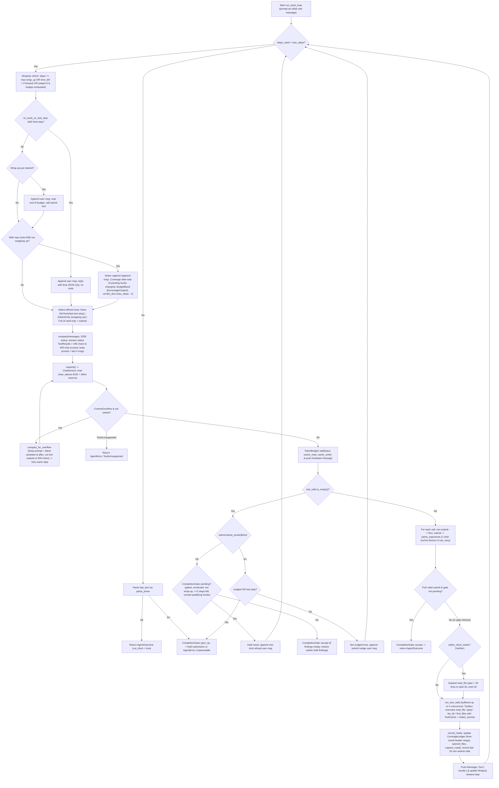
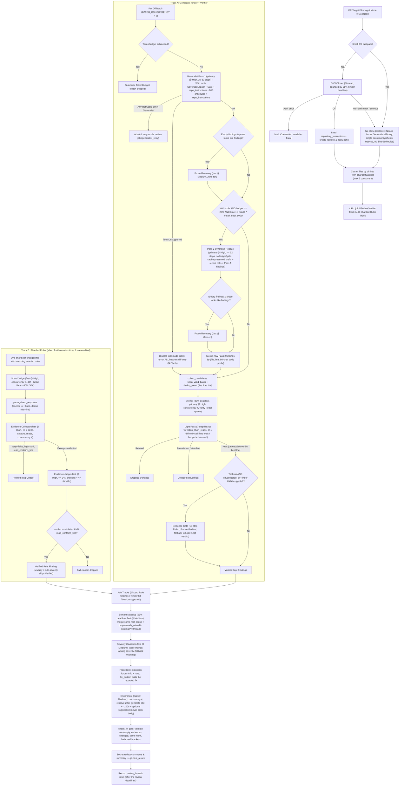
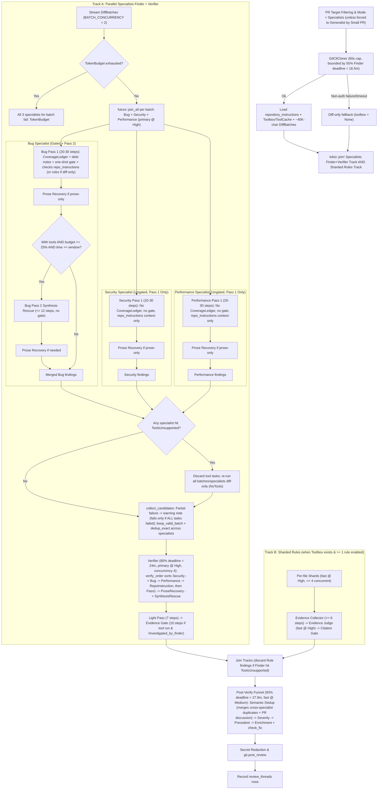

# Adus Architecture

> **Scope:** This document describes the runtime architecture of **Adus** as implemented in the workspace crates and specified in [SPEC.md](./SPEC.md). If any detail conflicts with [SPEC.md](./SPEC.md) or an active change spec under `docs/superpowers/specs/`, the spec governs.

---

## 1. System Overview & Deployment Topology

Adus is a single-tenant, self-hosted AI code review platform (`@adudu`) shipped as a single Rust binary (`adus`) backed by **PostgreSQL 18** and **Redis 8**. There are no external sandbox containers or separate message-broker services; repository inspection runs inside ephemeral shallow Git clones managed directly by the review engine.



---

## 2. Crate Workspace & Dependency Boundaries

Dependencies across the Rust workspace are strictly acyclic:

```text
crates/core     Config, AES-256-GCM Cipher, default ignore globs, shared domain types (ReviewMode, Job, normalize_path)
crates/db       sqlx Postgres pool + embedded migrations (0001..0010); users, sessions, connections, repositories, ai, settings, usage, reviews, review_threads, rules, memories, learning_runs
crates/git      GitProvider / GitProviderFactory traits, CloneSpec, diff utilities (commentable_lines, commentable_hunks, unified_patch), GitHub & Azure clients
crates/llm      LlmClient / ChatService traits, OpenAI / Anthropic / Gemini / OpenAI-compatible clients, ReasoningEffort, LlmRouter
crates/queue    Redis Streams job queue (XADD, XREADGROUP, XAUTOCLAIM), delivery dedup, distributed per-PR lock, worker heartbeats
crates/review   Review & learning engine: workspace, tools, redact, repo_instructions, agent, coverage, specialists, finder, rules_judge, rules_evidence, verifier, discussion, dedup, severity, enrich, budget, small_pr, prompt, parse, trace, command, threads, learn, engine
crates/server   Axum router, AppState, ApiError/ApiJson/ApiPath/ApiQuery, cookie auth & RBAC, webhooks, doctor, embedded SPA
crates/adus     CLI binary (serve, gen-secret, check-config, doctor, healthcheck, rereview), worker loop & scheduler
web/            SvelteKit static SPA + shadcn-svelte (built to web/build and embedded into crates/server)
```



### Trait Seams

Dynamic dispatch (`dyn Trait`) is restricted to 6 explicit test/runtime seams:

| Trait | Crate | Production Impl | Purpose |
|---|---|---|---|
| `GitProvider` | `adus-git` | `GithubClient`, `AzureClient` | PR metadata, diffs, threads, comments, webhooks |
| `GitProviderFactory` | `adus-git` | `HttpGitProviderFactory` | Constructs provider client per `Connection` PAT |
| `LlmClient` | `adus-llm` | `OpenAiClient`, `AnthropicClient`, `GeminiClient` | Provider wire protocol & model discovery |
| `ChatService` | `adus-llm` | `LlmRouter` | Multi-key LRU routing, cooldowns, usage tracking |
| `JobRunner` | `adus` | `Engine` | Executes `ReviewPr`, `PrComment`, `ThreadReply`, and `LearnPr` jobs |
| `RepoCloner` | `adus-review` | `GitCliCloner` | Ephemeral shallow PR checkout (`git >= 2.31`) |

All internal review dispatch (specialists, tools, parsers) uses closed enums and static dispatch.

---

## 3. Queue, Worker & Timeout Hierarchy

### Job Ingestion & Execution

1. **Ingestion:** Webhook handlers (`POST /webhooks/github/{repo_id}`, `POST /webhooks/azure/{repo_id}?token=...`) and `adus rereview <repo_id> <pr>` enqueue `Job` payloads (`review_pr`, `pr_comment`, `thread_reply`, `learn_pr`) onto Redis Stream `{prefix}:jobs`. Webhook deliveries are deduplicated atomically via `ENQUEUE_ONCE_SCRIPT` (`SET NX EX 86400` + `XADD`).
2. **Worker Loop (`crates/adus/src/worker.rs`):** Each worker refreshes a 30 s heartbeat key (`{prefix}:worker:{name}:hb`) every 10 s and reads from consumer group `adus-workers` (`XREADGROUP`, reclaiming idle entries after `RECLAIM_IDLE = 35 min`).
3. **Per-PR Serialization:** Before running any job, `handle_delivery` acquires Redis lock `pr:{repository_id}:{pr_number}` (`LOCK_TTL = 35 min`). If busy, the delivery is re-queued to `{prefix}:delayed` with a 30 s delay without incrementing `attempt`.
4. **Isolation & Retries:** Jobs execute inside an isolated `tokio::spawn` bounded by `JOB_TIMEOUT = 33 min`:
   - `Ok(())` -> `XACK`.
   - `EngineError::Retryable` -> while `attempt < MAX_ATTEMPTS (5)`, scheduled into `{prefix}:delayed` with `max(retry_after, backoff(attempt))`, then promoted back to `{prefix}:jobs` every 1 s by `run_scheduler`. For `review_pr`, the engine deletes its `reviews` row on `Retryable` so the retry starts clean; if all 5 attempts fail, `JobRunner::gave_up` inserts a `failed` row.
   - `EngineError::Fatal` -> moved immediately to `{prefix}:jobs:dead`; for `review_pr`, `reviews` row is marked `failed`.

### Compile-Time Timeout Hierarchy

`crates/adus/src/worker.rs` enforces strict nesting via compile-time assertions so a stuck review is always recorded cleanly before locks or stream claims expire:

```text
REVIEW_TIMEOUT (20 min, Generalist & Small PR)
  < SPECIALISTS_REVIEW_TIMEOUT (30 min, Specialists)
  + VALIDATE_TIMEOUT (2 min, push validation before the review budget starts; engine backstop = 30 + 2 min)
  < JOB_TIMEOUT (33 min, worker tokio::spawn backstop)
  < LOCK_TTL (35 min) == RECLAIM_IDLE (35 min) == reviews::STALE_AFTER (35 min)
```

Within each review run (`start = Instant::now()` in `Engine::run`), stage deadlines are fractions of the active mode's budget:

| Stage | Fraction | Generalist (20 min) | Specialists (30 min) |
|---|---|---|---|
| **Clone + Finder + Sharded Rules** | `55%` | `11.0 min` | `16.5 min` |
| **Verifier (Light + Evidence Gate)** | `80%` | `16.0 min` | `24.0 min` |
| **Post-Verify Funnel (Dedup -> Severity -> Enrich)** | `93%` | `18.6 min` | `27.9 min` |
| **Formatting, Redaction & Posting** | remaining `7%` | `1.4 min` | `2.1 min` |

---

## 4. AI Router & Provider Wiring (`crates/llm`)

`LlmRouter` (`ChatService`) sits between `crates/review` and `LlmClient`:

- **Key Selection:** Loads enabled keys for the provider (`status != 'invalid'`, `cooldown_until` elapsed) ordered by `last_used_at` (LRU). Each key is tried at most once per `chat` call.
  - `RateLimited` -> sets key cooldown (`Retry-After` clamped to 3600 s, default 60 s) and tries next key.
  - `Unauthorized` -> marks key `invalid` (guarded in SQL so nothing overwrites `invalid`) and tries next key.
  - `Transient` (5xx / timeout / transport) -> tries next key.
  - `Invalid`, `ToolsUnsupported`, `ContextOverflow` -> returned immediately without penalizing key health.
- **Reasoning Effort & Reserves:**
  - `ReasoningEffort::{Low, Medium, High}` adds an output token reserve (`4,096` / `12,000` / `23,000`) to `max_tokens` and bumps per-request HTTP timeout from `120 s` to `300 s`.
  - **Anthropic:** `claude-*` <= 4.5 uses `thinking: {"type": "enabled", "budget_tokens": reserve}`; 4.6+ uses `thinking: {"type": "adaptive", "display": "summarized"}` and `output_config: {"effort": ...}`. Claude Fable / Opus 5+ / Sonnet 5.5+ opt into `anthropic-beta: server-side-fallback-2026-07-01` (`fallbacks: "default"`), discarding any content blocks emitted before a `fallback` switch block. Safety refusals (`stop_reason: "refusal"`) fail as `Invalid`.
  - **Gemini:** 3+/4+ models receive `thinkingConfig.thinkingLevel` (`LOW` / `MEDIUM` / `HIGH`); older/unversioned models receive `thinkingBudget`. Thought signatures are preserved in `provider_meta`.
  - **OpenRouter:** `OpenAiClient` detects `openrouter.ai` / `*.openrouter.ai` hosts and sends `reasoning: {"effort": ...}` + `provider: {"require_parameters": true}`, retrying once without `require_parameters` on `"no endpoints found"`.
  - **Effort Fallback:** If a non-404 `Invalid` response indicates unsupported reasoning parameters or token-cap overflow while `effort` is set, the client transparently retries once with `effort: None`.
- **Prompt Caching:** Anthropic places up to 4 `cache_control: {"type": "ephemeral"}` breakpoints (system prompt, last tool definition, last block of latest user/tool message). Both Finder and Verifier keep static system prefixes and append-only message histories so prefix caching remains intact across steps and Synthesis Rescue.
- **Usage Accounting:** Every call writes a row to `llm_usage` (`input_tokens` normalized across providers to include `cache_read_tokens` + `cache_write_tokens`, plus `output_tokens`, `latency_ms`, `success`, `error_kind`).

---

## 5. Review Pipeline Entry & Pre-Filters (`crates/review/src/engine.rs`)

Before spawning any LLM agents, `Engine::review_pr` executes deterministic gating and diff preparation:

1. **Eligibility & Metadata:** Checks `repo.enabled`, `repo.auto_review` (bypassed by `Trigger::Command`), fetches PR (`base_sha`, `head_sha`), and resolves `(provider_id, primary_model, effective_fast_model())`. On `Updated` / `Command` it first runs push validation of open finding threads (§10; capped at `VALIDATE_TIMEOUT = 120 s`, its time added back to the review budget), then skips drafts (unless `Command`) and `ignored_title_keywords` (unless `Command`).
2. **Diff Scope:**
   - `Trigger::Opened` / `Trigger::Command` -> `full_targets` (all `+` lines in `pr_diff`).
   - `Trigger::Updated` -> looks up `reviews::last_done`; if `head_sha` matches, skips (`already_reviewed`). Otherwise computes `diff_between(last_head, head_sha)` and intersects hunks with the full PR diff (`incremental_targets`), falling back to full diff if force-pushed (`NotFound`).
3. **Target Filtering:**
   - Drops `Deleted` files first (never counted as ignored).
   - Drops files matching `effective_ignore_paths` (`normalize_path` against `globset`), summarized as `"N files ignored"`.
   - Skips binary/patchless files (`no_patch`), files with empty commentable lines, files over `max_patch_lines_per_file` (`too_large`, default 1500), and files past `max_files_per_review` (`file_limit`, default 30).
4. **Mode, Small PR & Context Load:**
   - Effective mode = `mode_override ?? repo.review_mode ?? settings.review_mode`.
   - Checks `small_pr::is_small_pr` (non-command, `small_pr_max_lines > 0`, `1..=3` files, total `+`/`-` <= `small_pr_max_lines`, no risky path, no matching enabled `critical` rule). If true, forces `ReviewMode::Generalist` and skips cloning (`"Small change — reviewed diff only"`).
   - Fetches existing PR discussion once via `git.list_pr_threads` (best-effort; used later by Semantic Dedup).
5. **Ephemeral Clone & Shared Budget:**
   - Unless Small PR, `GitCliCloner::clone_pr` clones `refs/pull/{n}/head` (GitHub) or `head_sha` (Azure) into `<temp>/adus-clones/adus-{uuid}/` with `CLONE_TIMEOUT = 60 s`, stripped env, PAT via `GIT_CONFIG_*`, hooks/symlinks/LFS/submodules disabled, `500 MB` cap, bounded by `deadlines.finder`.
   - Clone auth failure -> marks connection `invalid` and returns `Fatal`. Any other clone error/timeout falls back to diff-only (`"Codebase context unavailable — reviewed diff only"`).
   - If clone succeeds, loads `<repository_instructions>` (`AGENTS.md`, `CLAUDE.md`, `.github/copilot-instructions.md`, `.cursor/rules/*.mdc`, secret-redacted, 8,000-char cap) and creates one shared `Toolbox` (`ToolCache` + `RepoWorkspace`).
   - Clusters targets by parent directory into `DiffBatch`es (`MAX_BATCH_CHARS = 40,000`) and creates the shared cache-weighted `TokenBudget`.

---

## 6. Agentic Core Loop (`crates/review/src/agent.rs`)

All tool-using agents in Adus — **Finder** (Pass 1 & Synthesis Rescue), **Verifier** (Light & Evidence Gate), and **Sharded Rules Evidence Collector** — run on one unified ReAct loop: `agent::run_react_loop`, while all non-tool LLM calls (`dedup`, `severity`, `enrich`, `prose_recovery`, `rule_shard`, `rule_judge`, `verify_diff_only`, `learn`, `thread_reply`, `thread_validate`) run through `agent::chat_single_turn`.

Every prompt and response through both functions is secret-redacted and emitted to the `adus_review::trace` target when `--trace` / `ADUS_TRACE` is enabled.

### Configuration Matrix by Caller

| Caller | Model & Effort | `max_steps` | `wrap_up_steps` | `coverage_ledger` & `enforce_gate` | `budget_bands` | `no_tools_on_last_step` | `widen_short_reads` | `capture_reads` |
|---|---|---|---|---|---|---|---|---|
| **Finder Pass 1** (`Generalist`, `Bug` w/ tools) | `primary` @ `High` | `20..=30` | `2` | Yes | Yes | No | No | No |
| **Finder Pass 1** (`Security`, `Performance`, or diff-only) | `primary` @ `High` | `20..=30` | `2` | No | Yes | No | No | No |
| **Finder Pass 2** (`SynthesisRescue` for `Generalist`/`Bug`) | `primary` @ `High` | `min(max_steps, 12)` | `2` | No | Yes | No | No | No |
| **Verifier Light** (w/ tools) | `primary` @ `High` | `7` | `1` | No | No | Yes | Yes | No |
| **Verifier Evidence Gate** (w/ tools) | `primary` @ `High` | `10` | `1` | No | No | Yes | Yes | No |
| **Rule Evidence Collector** (w/ tools) | `fast` @ `High` | `6` | `1` | No | No | Yes | No | Yes |

### ReAct Loop Execution Flow



### Key Loop Mechanisms

1. **Append-Only Conversation History:** Coverage debt notes, `Encourage` / `Urgent` step-budget bands, and `verdict_due` notes are pushed as permanent `Message::User` entries. Never rewriting earlier turns preserves Anthropic/Gemini prompt-cache prefixes and Anthropic thinking-block validity.
2. **Per-Hunk `CoverageLedger` & One-Shot Gate (`coverage.rs`):**
   - Active only on **Pass 1 with repo tools** for `Generalist` and `Bug` (not `Security`, `Performance`, `SynthesisRescue`, or `Verifier`).
   - Tracks every non-deleted file with commentable right-side hunks. Only qualifying files (excluding docs `.md`/`.mdx`/`.rst`/`.txt` and test paths `*_test.*`, `*.test.*`, `*.spec.*`, `tests/**`, `__tests__/**`) generate debt.
   - Credited solely from the `[path: lines X-Y of Z]` header of successful `read_file` results (merged into contiguous windows; `0-0` covers empty files). `grep`/`list_dir`/`find_files` and same-turn reads do not satisfy debt.
   - When the model submits before reading all qualifying hunks (while not wrapping up and with `>= 2` investigating steps left), the gate refuses **once**, holds the submission as fallback (`cut_short` if the run later fails to submit, or restored if a subsequent accepted submission returns `[]`), and accepts the next submission unconditionally.
3. **Anchor Validation Bounce:** On a `submit_findings` call while steps remain (`can_retry = true`), `SubmitFindings` checks once (`anchor_retried`) that every finding's file is in the batch and `line` is a commentable `+` line, bouncing with valid file names or the 5 nearest `+` lines on mismatch.
4. **Sandboxed `Toolbox` & `ToolCache` (`tools.rs`, `workspace.rs`):**
   - `read_file` (max 200 lines / 8,000 chars, rejects binary & > 2 MB), `grep` (40 groups / 8,000 chars, 10 s / 64 KB-per-line budget), `list_dir` (150 entries / 4,000 chars), `find_files` (150 paths / 4,000 chars).
   - Every path is validated via `RepoWorkspace::resolve` -> `RepoPath` (blocks `..`, `.git`, symlink escapes, and secret files like `.env`, `*.pem`, `*.key`, `id_rsa*`, `.npmrc`).
   - All successful tool outputs pass through `redact_secrets` before entering the shared per-review `ToolCache` (time-cut searches are never cached).

---

## 7. Generalist Mode Flow

In `ReviewMode::Generalist` (default, and also forced for Small PRs), each ~40K-char diff batch is reviewed by **1 `Generalist` Finder agent** applying Bug, Security, and Performance lenses plus `<repository_instructions>` checks. When repository tools and enabled team rules exist, **Sharded Rules** run concurrently beside Finder + Verifier.



---

## 8. Specialists Mode Flow

In `ReviewMode::Specialists` (configured globally, per-repo, or via `@adudu review deep` / `@adudu review specialists`), the run budget expands to `SPECIALISTS_REVIEW_TIMEOUT` (**30 min**), and each diff batch spawns **3 independent specialist agents in parallel**: `Bug`, `Security`, and `Performance`.

### How Specialists Differ from Generalist

| Aspect | Generalist Mode | Specialists Mode |
|---|---|---|
| **Run Budget & Stage Deadlines** | `20 min` (`11m` / `16m` / `18.6m`) | `30 min` (`16.5m` / `24m` / `27.9m`) |
| **Agents per Batch** | `1` (`Generalist`) | `3` in parallel (`Bug`, `Security`, `Performance`) |
| **System Prompt Prefix** | `<ReviewInstructions>` + `<Role>` | Identical `<ReviewInstructions>` prefix across all 3 specialists (maximizes prompt-cache sharing); only trailing `<Role>` differs |
| **`CoverageLedger` & Completion Gate** | `Generalist` Pass 1 (with tools) | `Bug` Pass 1 only (with tools); `Security` & `Performance` are ungated so narrow lenses can skip unrelated files |
| **Synthesis Rescue (Pass 2)** | `Generalist` (with tools) | `Bug` only (with tools); `Security` & `Performance` run Pass 1 only |
| **`<repository_instructions>` Enforcement** | Checked by `Generalist` | Checked by `Bug` (`category: "repo_instruction"`); `Security` & `Performance` treat it as context only |
| **Diff-Only `<rules>` Fallback** | Checked by `Generalist` | Checked by `Bug` only (`checks_rules_diff_only`); `Security` & `Performance` never receive `<rules>` |
| **Partial Task Failure Handling** | Any retryable failure retries the whole review (`generalist_retry`) | Surviving batches/specialists still proceed and post with summary notes (only fails if **all** tasks fail) |

### Specialists Execution Flow



---

## 9. Verifier, Post-Verify Funnel & Token Budget Details

### Verifier (`crates/review/src/verifier.rs`)
- **Refute-to-drop, keep-by-default:** Every Finder candidate is queued (no candidate count cap) sorted by `verify_order`:
  1. Category: `security` -> `bug` -> `performance` -> `repo_instruction`
  2. Origin: `Pass1` -> `ProseRecovery` -> `SynthesisRescue`
  3. Original position
- **Two-tier verification:** Every queued candidate gets a **Light** run (`VERIFY_LIGHT_MAX_STEPS = 7` with `widen_short_reads` + `no_tools_on_last_step`, or a single diff-only call `verify_diff_only` if tools are disabled or the token budget is exhausted). Findings kept by a tool-enabled Light run on a file the Finder never opened (`!investigated_by_finder`) enter the **Evidence Gate** (`VERIFY_FULL_MAX_STEPS = 10`). If the Evidence Gate is cut or fails without a verdict, the Light `Kept` verdict stands.
- **Unreadable vs. Unverified:** A Light/diff-only run that finishes and replies with unreadable text **keeps** the finding (`kept_unreadable`); a run cut by the deadline or failing with a chat error drops it (`dropped_unverified`).

### Post-Verify Funnel (`dedup.rs`, `severity.rs`, `enrich.rs`)
1. **Semantic Dedup:** Single-turn call (`fast_model` @ `Medium`, `1,024` tokens) over Verifier-kept + Sharded-Rules findings and `<existing_comments>` (up to 60 PR threads within `40,000` chars, bodies redacted & capped at `1,000` chars). Merges same-root-cause findings and drops `already_raised` findings (including prior `@adudu` comments). Safe fallback keeps all findings.
2. **Severity Classifier:** Single-turn call (`fast_model` @ `Medium`, `1,024` tokens) labels findings with `severity: None` (`ShardedRules` findings keep `rule.severity`). Any missing/failed label defaults to `Warning`.
3. **Precedent (`prompt::apply_precedent`):** The Verifier has already checked each kept finding's `precedent` index against `<memories>` and cleared any it answered `precedent_matches: false` for (`precedents_cleared`). A finding whose `precedent` index names an `exception` memory is forced to `Info` with a "declared by design / won't fix" note; a `fix_pattern` keeps its severity and gets a "similar case was fixed" note. Conventions and invalid indices are ignored. It runs after Severity so the classifier cannot undo it.
4. **Enrichment & `check_fix`:** One call per finding (`ENRICH_CONCURRENCY = 4`, `fast_model` @ `Medium`, `2,048` tokens, stops starting inside `ENRICH_RESERVE = 20 s` before `post_verify`) adds a `title` (<= 100 chars; fallback = first sentence of `body`) and optional `suggestion` + `start_line`. **The Finder's verified `body` is never rewritten.** `check_fix` validates every suggestion against `CommentableRange` and bracket balance (`()`, `[]`, `{}`), stripping invalid suggestions while keeping the comment.

### Cache-Weighted `TokenBudget` (`crates/review/src/budget.rs`)
- `settings.max_review_input_tokens` (`0` = unlimited) is shared across Finder, Sharded Rules, Verifier, and post-verify stages.
- `TokenBudget::add(input, cache_read, cache_write)` charges `uncached + ceil(min(cache_read, input) / 4)`, discounting prompt-cache hits to one quarter while still logging full raw counts in `review stages finished`.
- Soft cap behavior when exhausted: active ReAct loops enter wrap-up on their next step, unstarted Finder batches and Sharded Rules work are skipped, Pass 2 Synthesis Rescue is skipped, Verifier runs switch to single-turn diff-only calls (no Evidence Gate), while Semantic Dedup, Severity, and Enrichment still run.

---

## 10. PR Commands, Thread Conversations & Closed-PR Learning

- **`@adudu` Commands (`crates/review/src/command.rs`):** `Job::PrComment` verifies the commenter is a non-disabled Adus user (by email on Azure, `github_login` or public email on GitHub; ignoring Adus's own comments, whose trimmed body starts with `<!-- adudu -->`), parses `@adudu review [generalist|deep|specialists]` (enqueues `Job::ReviewPr` with `Trigger::Command`) or `@adudu remember: <text>` (stores an `active` repo memory and replies), or replies with command help.
- **Thread conversations (`crates/review/src/threads.rs`):** After a review posts, the engine records one `review_threads` row per posted finding. A human reply in such a thread enqueues `Job::ThreadReply`: one traced single-turn call (`"thread_reply"`, `fast_model` @ `Low`) judges the reply against the finding and code, answers in the thread and updates its outcome and provider status. On `Updated`/`Command` reviews, `validate_open_threads` (`"thread_validate"`, `fast_model` @ `Low`, capped at `VALIDATE_TIMEOUT = 120 s`, not counted against the review budget) checks open threads whose files changed and resolves the fixed ones; the summary reports "N earlier finding(s) confirmed fixed".
- **Closed-PR Learning (`crates/review/src/learn.rs`):** When a PR closes/merges/abandons, webhooks enqueue `Job::LearnPr`. If `repo.enabled`, `learning_mode != off`, and `pr_learning_runs` has no entry for `(repo_id, pr_number, head_sha)`, `Engine::learn_pr` runs one curator `chat_single_turn` (`"learn"`, `primary_model` @ `settings.curator_effort`, `16,384` tokens) over `review_threads` outcomes and human discussion threads, alongside `<known_memories>` and `<rejected_memories>`. It yields up to `settings.max_learned_per_pr` `convention`, `exception` and `fix_pattern` repo memories (`source = pr_learning`), which may supersede similar existing ones; `learning_mode` decides whether they start `active` or `pending` (SPEC §8.5).
